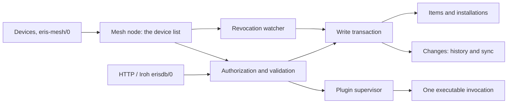

# Core architecture

The store has three persistent concepts, and the core keeps its place in its
owner's mesh beside them:

| Concept | Storage | Responsibility |
|---|---|---|
| Item | `items` | A facet, JSON body, revision, timestamps, and last writer. Facet definitions are items too. |
| Change | `changes` | An immutable item snapshot or core event, ordered by a durable cursor. The same rows serve history and synchronization. |
| Installation | `clients` | An app a device let in: its Iroh key, the device, the note, and its grants. Its key is its credential. |
| Mesh | `mesh` | The note that approves this core as the mesh's ErisDB, and its copy of the device list. |
| Passphrase | `passphrase`, `passphrase_guesses` | The enrollment passphrase's Argon2id hash, and each device's wrong guesses. |

The HTTP API performs authentication, authorization, and schema validation.
`store::Write` owns a database transaction and its source attribution. Its create,
update, and delete methods write the item and corresponding change together.
Installation changes append their audit event in the transaction that updates
the installation, whoever makes them: an enrolling device, the operator, or the
mesh. Dropping a failed transaction rolls back both state and history.

The core's mesh node is the one long-lived thing a replica runs besides its
listeners. It keeps the device list current — devices push every entry to it —
and saves it to the `mesh` row. Authorization reads the list in memory: an app
counts while its device is a member and its note unrevoked, and the core lets apps
in while its own note counts. A watcher revokes the installations a removal or
revocation ends, as soon as the list carries it, and logs when the core's own
note stops counting.



## Ordering and subscriptions

Writers take item or installation locks before the shared append lock. They hold
the append lock until commit, keeping sequence order consistent with visibility.
Subscribers can therefore resume from one sequence number without missing slower
writers. PostgreSQL notifications wake subscribers; the change table supplies the
events and remains the source of truth after disconnects.

SSE subscriptions use a separate bounded connection pool for `LISTEN`. An idle
subscription cannot consume a request connection. Each event is checked against
current installation authority and the mesh; idle streams check expiry,
revocation and the mesh at least every second.

A tick appends its event and runs one SQL sweep across all facet lapse rules.
Lapses are deduplicated by item ID and revision. Transaction timestamps are not
edit identities: a writer that waited on a lock can start before the preceding
tick and still commit a new revision afterward.

## Schemas and processes

`schema::compile` checks local references and compiles schemas before either a
facet definition or plugin operation becomes usable. Invalid facet schema edits
leave the previous definition and its revision intact. Compiled facet validators
are cached by name and schema value.

Plugins have one supervisor owning the executable, stdin, stdout, stderr, and
concurrency permit. The deadline covers the whole invocation, including process
exit after stdout closes. Disconnects and failures reap the executable before
releasing capacity. Headers are bounded while being read; bodies stream with
backpressure. Plugin calls do not enter the item or change tables.

The Rust client similarly has one HTTP-over-QUIC response primitive. Buffered
requests, plugin output, and change subscriptions all share connection setup and
stream cleanup. Only safe reads retry after an ambiguous transport failure.

Passphrase checks lock the guessing device's row for the length of the Argon2id
hash, so guesses sent at once are counted one after another.

## Verification

The integration suites exercise real PostgreSQL, HTTP, Iroh/QUIC, CLI processes,
plugin executables, and real mesh participants: device nodes built from the mesh
library, joining the erisdb binary to their mesh, enrolling apps from their own
endpoints, and removing devices and revoking notes, all on loopback endpoints.
ErisAuth's agent socket is a stand-in answering as ErisAuth does. Client retry
tests forward to the real core and deliberately drop a response after the
operation commits, then check the resulting database state. They do not
fabricate server responses. Small pure tests remain for parsing, permissions,
the lockout schedule, and domain rules; network and persistence behavior is
covered across the real boundaries.

With Docker available, run the Rust and launcher suites:

```sh
cargo test --locked --manifest-path erisdb/Cargo.toml
cargo test --locked --manifest-path erisdb-client/Cargo.toml
cargo test --locked --manifest-path clients/mcp/Cargo.toml
python3 tests/local/test_launcher.py
```

Run browser tests with `npm run test:e2e` after installing the npm dependencies
and Playwright Chromium; they run ErisAuth beside the core, built from
`ERISAUTH_SOURCE` (`../ErisAuth` by default). `ERISDB_CHROMIUM` can select an
installed Chromium.
Build both Android apps with `scripts/build-android.sh`, start an isolated
emulator, then run `bash tests/android/run.sh`. The device suite covers offline
queues across process restarts, revision conflicts, narrowed authority,
paginated synchronization, cache recovery, CRUD, and revocation. It installs and
clears the test apps.

The OpenAI plugin's live tool-call and streaming test is opt-in because it calls
the provider. Set `OPENAI_API_KEY` and `ERISDB_TEST_OPENAI_MODEL`, then run:

```sh
cargo test --locked --manifest-path erisdb/Cargo.toml --test openai_plugin -- --ignored
```

## Measuring implementation size

Compare production Rust and SQL with a specific prior revision:

```sh
python3 scripts/core-loc.py --base REVISION
python3 scripts/core-loc.py --base REVISION --format
```

Both commands use CLOC on `erisdb/src` and `erisdb/migrations`, excluding inline
unit-test modules from both snapshots. The second applies identical rustfmt
settings to temporary copies so changes in line wrapping do not explain the
result. Tests outside the core, generated code, and dependencies are excluded.
Neither command changes the working tree.

Count both Android applications and their shared implementation together:

```sh
cloc --skip-uniqueness apps/*-android/app/src/main/java \
  apps/android-shared/src/main/java apps/*-android/app/build.gradle.kts
```

The Gradle files and shared sources count toward the total. `--skip-uniqueness`
also counts separate identical files, such as the JNI bridge before sharing.
